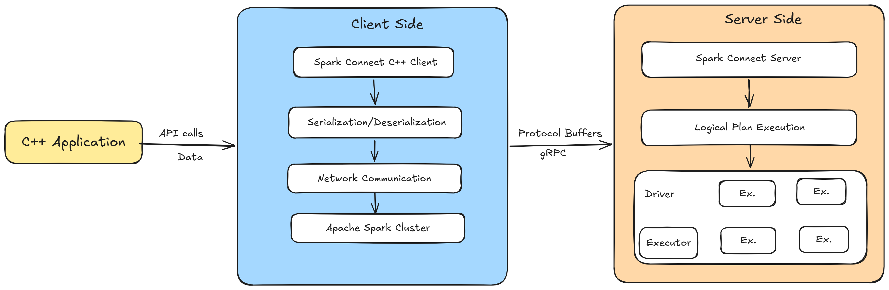

# Spark Connect C++

A **C++ client for Apache Spark** via **Spark Connect**, enabling C++ applications to execute Spark SQL workloads against remote Spark clusters without requiring JVM dependencies.

Spark Connect introduced a **decoupled client–server architecture** for Apache Spark, where client applications construct logical query plans that are executed remotely by a Spark server. This project delivers an **idiomatic, high-performance C++ interface** for building and submitting Spark queries, with efficient **Apache Arrow–based columnar data exchange** over gRPC.

The library is intended for environments where:

* Native C++ integration is required
* High-throughput data movement is necessary
* Tight control over memory and system resources is important
* Existing performance-critical C++ systems need to integrate with Spark

**Status:** *Work in Progress*




## Design Goals

* Native-first Spark integration for C++ ecosystems
* ~~Efficient Arrow-based columnar data transfer~~ _Spark 4.x.x^ will natively support Arrow.._
* Clear separation between client logic and remote Spark execution
* Compatibility with evolving Spark Connect protocols
* Compatibility with Spark versions **3.x.x** - **4.x.x**
* Predictable performance characteristics suitable for production systems
* Minimal runtime dependencies outside standard native infrastructure


## Use Cases

### Native Data Producers and High-Throughput Pipelines

Enable C++ services to run Spark workfloads.

### Integration with Legacy, Industrial, and Scientific Systems

Connect existing C++ infrastructure such as Industrial Control Systems, Financial Engines, Robotics Platforms, HPC pipelines, or Scientific Instrumentation directly to Spark for large-scale analytics.

### AI/ML and Inference Pipelines

Run high-speed inference using native libraries (e.g., TensorRT, ONNX Runtime, CUDA pipelines) and stream features, embeddings, or predictions into Spark for downstream analytics, feature engineering, and training workflows (Distributed ML).

### Distributed Graph Processing

Run Distributed Graph Algorithms at scale with [GraphFrames](https://graphframes.io/) natively.

### Interactive Analytics Clients

Develop native dashboards, monitoring tools, and backend services that execute Spark SQL queries through Spark Connect with minimal client-side overhead.

### Edge Gateways and Data Aggregation Services (IOT)

Use C++ aggregation services or gateway nodes to collect telemetry from distributed environments and forward metrics to remote Spark clusters for processing.


## When Should You Use the C++ Client?

The Spark Connect C++ client is **not a replacement** for Python or Scala Spark APIs. Instead, it enables Spark integration in environments where native execution, performance constraints, or system-level integration are required.

### Use the C++ Client When

* You are integrating Spark into an existing **C++ application or platform**
* Your environment cannot depend on a **JVM runtime**
* You are building **high-performance ingestion or producer services**
* You require integration with:

  * HPC systems
  * Scientific Computing pipelines
  * Robotics or Industrial Platforms
  * Embedded gateways or Native backend services

* You run **AI/ML inference pipelines** in C++ and need to forward structured outputs into Spark (Most common use case)
* You are implementing Proprietary Data Connectors or Binary Protocols

### Prefer Python or Scala Spark APIs When

* You are building notebooks or data science workflows
* Your team primarily consists of data engineers or analysts
* You require the full Spark API surface immediately
* Rapid prototyping is more important than native performance
* Your applications already run comfortably in JVM or Python environments

# Installation & Usage

## Conan
### Installation (Linux - Ubuntu, Debian)

Running the following commands will install & verify conan:

```sh
python3 -m venv .venv
source .venv/bin/activate

pip install conan
conan --version

# ---------------------------
# Conan version 2.3
# ---------------------------
```

Verify Conan profile:

```sh
conan profile show
```

Update Conan profile to target C++ 20:

```sh
 nano ~/.conan2/profiles/default

# -----------------------------------------
# [settings]
# arch=x86_64
# build_type=Release
# compiler=gcc
# compiler.cppstd=20
# compiler.libcxx=libstdc++11
# compiler.version=13
# os=Linux
# -----------------------------------------
```

Create a Conan build:

```sh
conan install . --output-folder=build/conan --build=missing
```


## Standard installation

```sh
mkdir -p build && cd build
cmake ..
make -j$(nproc)
cpack
```

This generates a **compressed archive** under the **build** directory. 

```
CPack: Create package using TGZ
CPack: Install projects
CPack: - Run preinstall target for: spark_connect_cpp
CPack: - Install project: spark_connect_cpp []
CPack: Create package
CPack: - package: /home/user/spark-connect-cpp/build/spark-connect-cpp-0.0.1-linux-amd64.tar.gz generated.
```

Extract the contents of the archive:

```sh
tar -xzf spark-connect-cpp-0.0.1-linux-amd64.tar.gz
```

You can verify the contents by running:

```sh
ls -F spark-connect-cpp-0.0.1-linux-amd64
```

Copy contents to global path:

```sh
sudo cp -r ~/spark-connect-cpp/build/spark-connect-cpp-0.0.1-linux-amd64/include/spark_connect_cpp /usr/local/include/
sudo cp ~/spark-connect-cpp/build/spark-connect-cpp-0.0.1-linux-amd64/lib/libspark_connect_cpp.a /usr/local/lib/

# --------------------------------------------------------------------------------------------
# Purpose of the pkgconfig directory
# --------------------------------------------------------------------------------------------
#
# The pkg-config directory serves as a central repository for metadata about installed libraries on a system. 
#
# It contains .pc files, which are the metadata files that provide information such as the 
# location of header files, library binaries, and various descriptive information. 
# 
# These files are essential for developers to retrieve package-specific compilation and linking parameters, 
# ensuring that applications are built correctly with all necessary components. 
#
# The pkg-config tool, which is invoked via its command line interface (CLI), reports library information via standard output, 
# allowing for the sharing of a codebase in a cross-platform way by using host-specific library information 
# that is stored outside of yet referenced by the codebase.
# --------------------------------------------------------------------------------------------
sudo mkdir /usr/local/lib/pkgconfig
sudo cp ~/spark-connect-cpp/build/spark-connect-cpp-0.0.1-linux-amd64/lib/pkgconfig/spark_connect_cpp.pc /usr/local/lib/pkgconfig/
```

Verify that the contents were copied successfully:

```sh
ls /usr/local/lib/pkgconfig
```

Update the Shared Library Cache:

```sh
sudo ldconfig
```

Verify Spark Connect C++ is accessible globally:

```sh
pkg-config --exists spark_connect_cpp && echo "Library is global" || echo "Library not found"
```

Running a sample application:

```cpp
#include <spark_connect_cpp/session.h>

int main()
{
    auto spark = &SparkSession::builder()
                     .master("sc://localhost")
                     .appName("demo")
                     .getOrCreate();

    auto df = spark->sql("SELECT 1 AS id");

    df.show();
}
```

Compile the sample application:

```sh
g++ src/main.cpp $(pkg-config --cflags --libs spark_connect_cpp) -o spark_app
```

Run the sample application:

```sh
./spark_app
```

**Output:**

```
+----------------------+
| id                   |
+----------------------+
| 1                    |
+----------------------+
```

For detailed development setup instructions, see:

* [Setup Guide](/docs/SETUP.md)
* [API Reference](/docs/API_REFERENCE.md)

## License

Apache 2.0